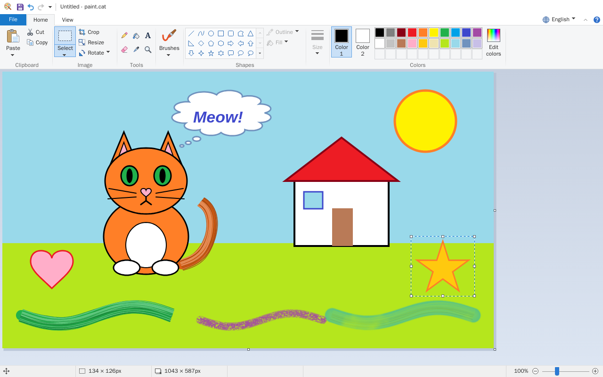

# paint.cat

**The classic Windows 10 Paint, in your browser.** Live at <https://paint.cat>.



paint.cat is a faithful replica of the classic Paint: its interface (Ribbon, File menu, dialogs, status bar) and its
behaviour. It has 9 brushes, 23 editable shapes, formatted text, rectangular and free-form selection, crop, rotate,
flip, resize and skew, zoom from 12.5% to 800%, rulers, gridlines, 50 levels of undo, and saving as PNG, JPG, BMP, GIF
and TIFF.

- **No server**: it is a static site. Everything happens in the browser and pictures never leave your computer.
- **Works offline** and can be **installed as an app** (PWA) on Windows, macOS and Linux.
- **English, Catalan and Spanish**, with the texts, tooltips and keyboard shortcuts of the original Paint in each
  language.

> paint.cat is not affiliated with Microsoft. Microsoft, Windows and Paint are trademarks of Microsoft Corporation.
> The icons, cursors and textures are original.

## Contributing

Found a bug or want to suggest a change? [Open an issue](https://github.com/iicc1/paint-cat/issues) or send a
[pull request](https://github.com/iicc1/paint-cat/pulls).

## Languages

- The app starts in the browser's language (`navigator.languages`) when it is Catalan, Spanish or English. Otherwise it
  uses English. Occitan maps to Catalan; Galician, Basque, Asturian and Aragonese map to Spanish.
- The language selector is in the tab row, next to _Minimize the Ribbon_ and _Help_ (KeyTip `Alt`, `L`). The choice is
  remembered in the browser.
- Everything lives on the same URL (no `/es` or `/en`). Switching language doesn't reload the page or lose the drawing.
- Keyboard shortcuts follow the language, as in Paint: in Spanish `Ctrl+G` saves and `Ctrl+E` selects all; in Catalan
  and English they are `Ctrl+S` and `Ctrl+A`.

Texts live in `src/i18n/`. `es.ts` is the reference catalog; `ca.ts` and `en.ts` have the same shape, and the compiler
reports any missing string. To add a language, create its catalog, register it in `src/i18n/index.ts` and add its
shortcuts in `src/ui/accel.ts`.

## Development (Docker, Node 24 LTS)

You don't need Node installed: everything runs in a `node:24-alpine` container.

```bash
docker compose up
```

Open <http://localhost:5173>. `node_modules` lives in a Docker volume, and Vite watches files by polling so it works
with folders shared from Windows or macOS. To use another host port: `PORT=5180 docker compose up`.

Other tasks:

```bash
docker compose run --rm app npm run check        # lint + types + tests + build
docker compose run --rm app npm test             # tests (Vitest)
docker compose run --rm app npm run build        # builds dist/
docker compose run --rm --service-ports app npm run preview   # serves dist/ at http://localhost:4173
docker compose run --rm app npm install <package>  # add dependencies
```

There is also a **Dev Container** configuration (`.devcontainer/`) for VS Code.

### Structure

| Folder       | Contents                                                                                   |
| ------------ | ------------------------------------------------------------------------------------------ |
| `src/app/`   | State, document with history (50 levels), view with zoom and rulers, selection, image ops  |
| `src/tools/` | Tools: pencil, brushes, eraser, fill, color picker, magnifier, shapes, selection and text  |
| `src/paint/` | Drawing engine: the 9 brushes and the geometry of the 23 shapes                            |
| `src/io/`    | Open and save (File System Access or download), BMP/GIF/TIFF encoders, clipboard, printing |
| `src/ui/`    | Ribbon, File menu, menus, dialogs, status bar, KeyTips, shortcuts, icons and cursors       |
| `src/i18n/`  | Catalan, English and Spanish texts, and language detection                                 |
| `analysis/`  | Specification of the original Paint, used as reference                                     |
| `scripts/og` | Sample scene used to generate the social preview image and the screenshot in this README   |

## SEO and social preview

- `index.html` has the title, description, canonical, Open Graph, the large X/Twitter card, JSON-LD
  (`WebApplication`) and `noscript` content in the three languages.
- `public/og-image.png` (1200×630) is the preview shown when the link is shared. `scripts/og/README.md` explains how to
  regenerate it.
- `robots.txt` and `sitemap.xml` are generated at build time for `https://paint.cat`.
- The PWA manifest declares icons, screenshots and `file_handlers` (open pictures with the installed app).
- HTTP headers (CSP, HSTS, `X-Frame-Options`, `Permissions-Policy`, caching…) are in `public/_headers`.

## CI

`.github/workflows/ci.yml` runs on every push and pull request: lint (oxlint), formatting (Prettier), types
(TypeScript 7), tests (Vitest) and build, and checks that the build contains the SEO files.

## License

[MIT](LICENSE) © Ignacio Iglesias
